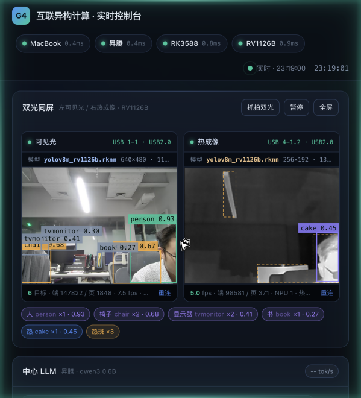
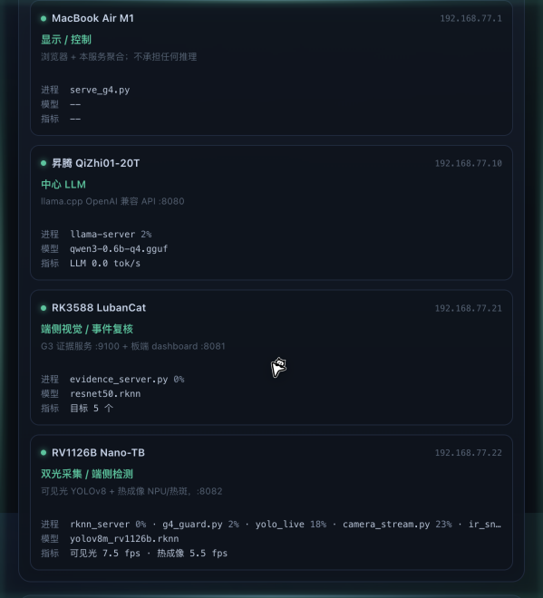
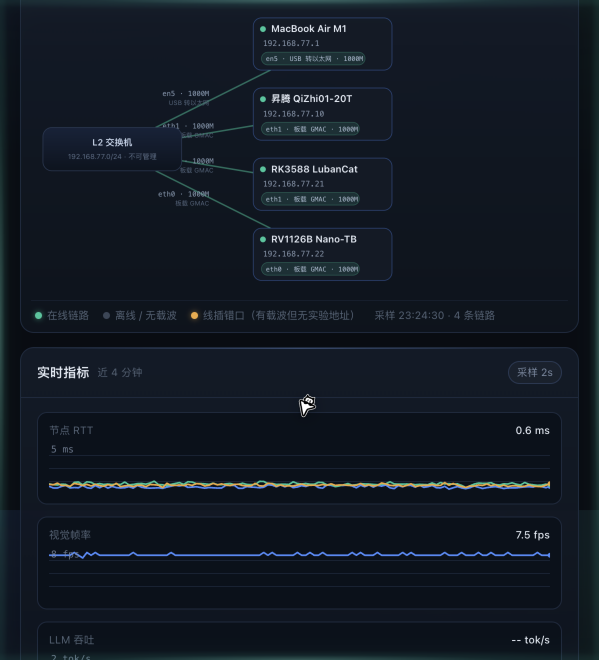
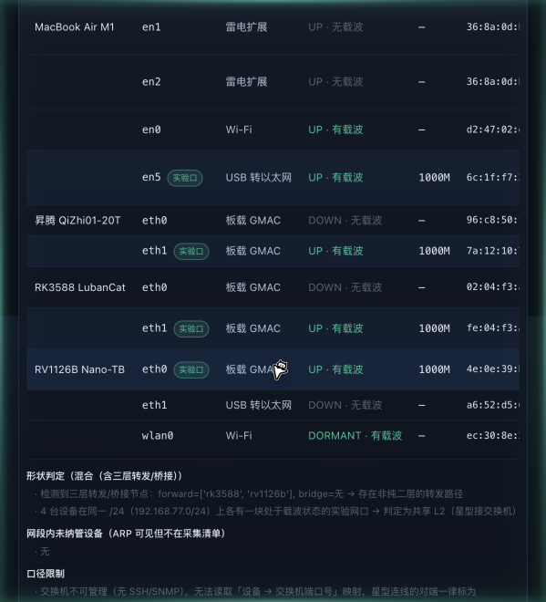
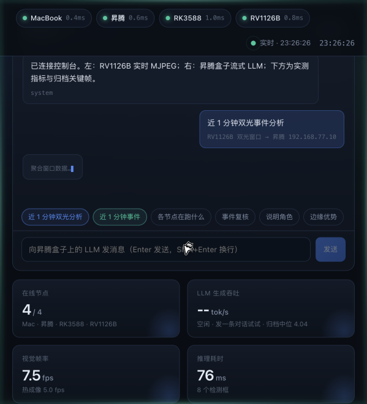
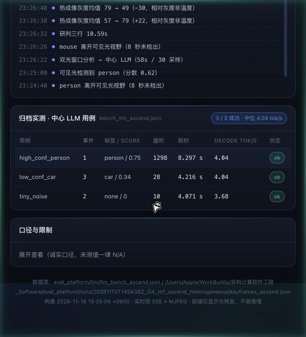

# 界面效果说明（截图对照）

> 用途：教师备课、学生自测时对照「每个部分跑对了应该长什么样」。
> 截图来自实机控制台（`http://127.0.0.1:8899/`），2026-11-18 采集。
> 数据（检测框、分数、帧率、RTT、tok/s）随现场变化，截图展示的是**结构与口径**，不是固定数值。

## 先看视频（打开即播）

<video src="../../视频教程/01-控制台总览.mp4" controls width="640"></video>

---

## 1. 双光同屏与端侧检测



**应有效果**

- 顶部四个节点胶囊（MacBook / 昇腾 / RK3588 / RV1126B）均亮绿点并显示 RTT；右侧 `实时 · 时间`。
- 「双光同屏」卡左上可见光、右上热成像，两路都标 **USB 接口 + USB2.0** 与模型名 `yolov8m_rv1126b.rknn`。
- 可见光：YOLOv8 框出 person / chair / tvmonitor / book，每框带类别 + 分数；底部显示 `目标数 · 帧号 · ~7.5 fps · 推理 ~76 ms`。
- 热成像：NPU 跨模态检出（人 / 热斑）用虚线框，底部 `~5 fps · NPU n · 热斑 n`。热像为 0~255 相对灰度，**无温度**。
- 下方目标标签行：可见光类 + 热成像类分列。

**跑错的迹象**：模型名显示 `--`、视频区「正在连接」、fps 为 0、只有单路有框、热成像出现摄氏度。

---

## 2. 节点分工（谁在跑什么）



**应有效果**

- 四个节点各一张卡：角色（显示/控制 · 中心 LLM · 端侧视觉/事件复核 · 双光采集/端侧检测）+ 一句职责说明 + IP。
- 每卡列出 **进程**（如 `serve_g4.py`、`llama-server`、`evidence_server.py`、`yolo_live`）、**模型**（如 `qwen3-0.6b-q4.gguf`、`resnet50.rknn`、`yolov8m_rv1126b.rknn`）、**指标**（tok/s、目标数、fps）。
- 数据由每 25 s SSH 实测；右上「立即刷新」可重采。

**跑错的迹象**：全部显示 `unavailable`、进程列 `--`、模型列 `--`（说明 SSH 别名/公钥未配或板端无 python3）。

---

## 3. 拓扑与实时指标



**应有效果**

- 拓扑 SVG：四节点卡片 + 「L2 交换机」，每条链路标 `网口 · 1000M · 介质`（`r8152` → USB 转千兆；`ethN` → 板载 GMAC）。
- 图例区分在线链路（绿）、离线/无载波（灰）、闲置口（黄）；下方「采样时间 · N 条链路」。
- 实时指标卡：近 4 分钟三条曲线——**节点 RTT / 视觉帧率 / LLM 吞吐**，采样 2 s；当前值显示在右上。

**跑错的迹象**：链路全灰或形状显示 `unknown`、曲线为空、RTT 一直 0（说明 SSH 采集失败或 SSE 未连接）。

---

## 4. 接口自动识别与形状判定



**应有效果**

- 表格逐行列出每个节点的网口：`设备 | 网口 | 介质 | 状态 | 速率 | MAC`。
- 实验口带「实验口」标签；介质由 `driver + sysfs 总线` 判定（如 `USB 转以太网`、`板载 GMAC`、`Wi-Fi`）。
- 「形状判定」段给出依据（是否旁挂三层转发/桥、哪些地址在同一网段、哪些口处于载体状态）。
- 「口径限制」段注明：交换机不可管理（无 SSH/SNMP/LLDP），设备→交换机端口映射一律 `inferred`。

**跑错的迹象**：介质列全 `--`、形状判定写死 `star` 而没有依据说明（属于硬编码，不是实测）。

---

## 5. 中心 LLM 与 KPI 卡



**应有效果**

- 对话区：系统消息说明数据源（左 RV1126B MJPEG、右昇腾流式 LLM、下方实测指标与归档帧）。
- 快捷 chip：`近 1 分钟双光分析` / `近 1 分钟事件` / `各节点在跑什么` / `事件复核`。
- 底部四个 KPI 卡：**在线节点 4/4**、**LLM 生成吞吐**（有实测时显示 tok/s，空闲显示 `--`）、**视觉帧率**（可见光 ~7.5 / 热成像 ~5.0）、**推理耗时**（~76 ms）。
- 两类问题口径不同：台账只列条目，研判只给三行判断/理由/建议（见 `../docs/03-user-guide.md`）。

**跑错的迹象**：KPI 全 `--` 但节点显示在线（SSE 断）、tok/s 出现 0.0（空闲应为 `--`）、问答把稳态说成事件。

---

## 6. 事件流与归档实测



**应有效果**

- 事件流按时间倒序列出状态切换：`person 离开可见光视野（8 秒未检出）`、`热成像灰度均值跳变`、`双光窗口 → 中心 LLM` 等，每条带时间戳。
- 「归档实测 · 中心 LLM 用例」表：3 条用例（high_conf_person / low_conf_car / tiny_noise），列事件数、标签/分数、面积、耗时、DECODE TOK/S、状态，右上角 `3/3 成功 · 中位 4.04 tok/s`。
- 「口径与限制」段：未测值一律 `N/A`，不填 0。

**跑错的迹象**：事件流刷屏（同目标频繁进出，说明去抖门限没生效）、归档表数字与 `bench_llm_ascend.json` 不符、出现摄氏度。

---

## 复现方式

```bash
# 启动控制台（档位 B/C）
cd 06-实验平台 && make doctor && make run
# 浏览器打开 http://127.0.0.1:8899/ ，按上表逐项对照
```

> 截图方法：用 WorkBuddy 内置浏览器导航到对应锚点（如 `#rosterGrid`、`#topoSvg`、`#msgs`），
> 截屏后存入本目录；系统级全屏截图可用 `screencapture -x <file.png>`（Chrome 需在前台且已加载）。
