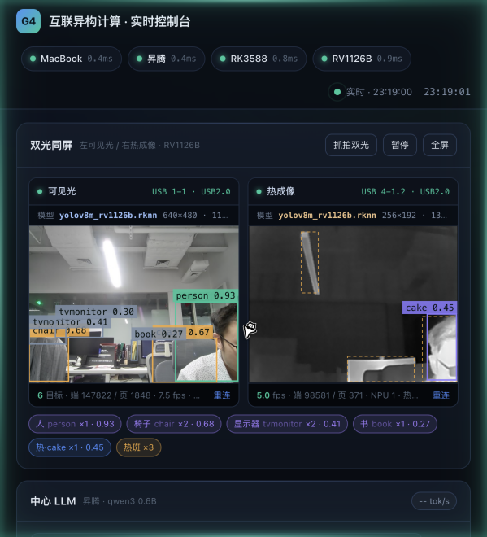
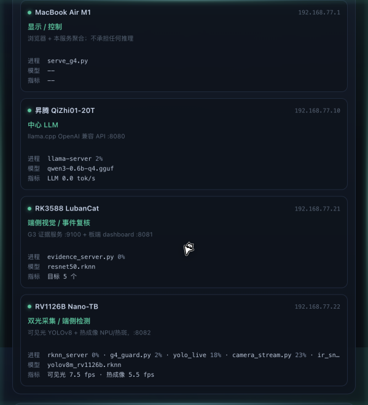
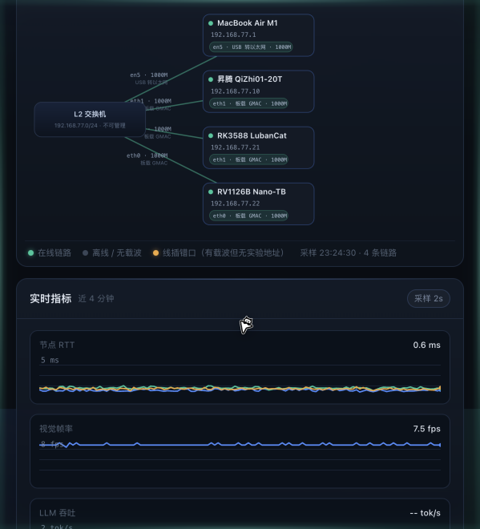
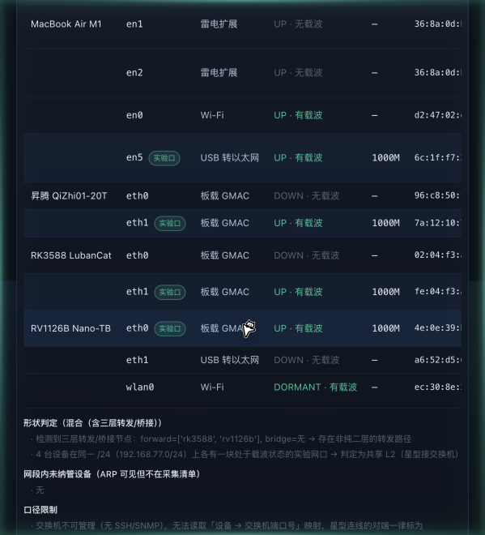
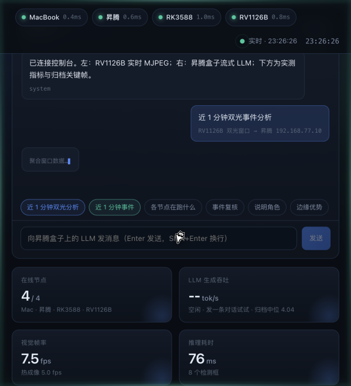
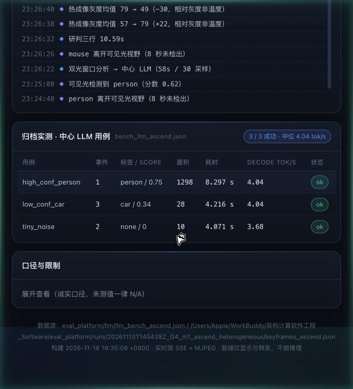

# 《多核异构互联计算》课程产品包 · V6.4

> 面向高校集成电路 / 计算机 / 人工智能相关专业的校企共建课程产品，48 学时 / 3 学分 / 18 周。定制、版权、采购、合作请联系 bingchen199802@gmail.com。

---

## 界面速览 · 打开即看

> 全部为实机控制台截图与录屏。视频点播放键即可看；截图点开可放大。

**① 控制台总览（录屏 6s）**

<video src="视频教程/01-控制台总览.mp4" controls width="680"></video>

**② 双光同屏与端侧检测（录屏 5s）**

<video src="视频教程/02-双光同屏与端侧检测.mp4" controls width="680"></video>

**③ 中心 LLM 与事件研判（录屏 5s）**

<video src="视频教程/03-中心LLM与事件研判.mp4" controls width="680"></video>

**六大区域实机截图**

| 区域 | 截图 |
|---|---|
| 双光同屏与检测框 |  |
| 节点分工（谁在跑什么） |  |
| 拓扑与实时指标 |  |
| 接口自动识别 |  |
| 中心 LLM 与 KPI |  |
| 事件流与归档实测 |  |

> 每个区域的「应有效果 / 跑错迹象」对照见 [`06-实验平台/docs/08-界面效果说明.md`](06-实验平台/docs/08-界面效果说明.md)。

---

## 🔓 在线解锁入口（推荐）

**[🔓 在线解锁入口](https://zforce0.github.io/heterogeneous-computing-course/unlock.html)** — 浏览器内输入密码，即可查看/下载全部核心材料（PPT / 教具包 / 手册 / 测评 / 教案）。密码仅在本地校验与解密，不上传任何服务器。

> 在线地址：https://zforce0.github.io/heterogeneous-computing-course/unlock.html
> 本地等价：在仓库根目录运行 `python3 -m http.server 8000` 后访问 `http://localhost:8000/unlock.html`；或命令行 `KIT_PASSWORD='<授权密码>' python3 scripts/protect_core.py decrypt`。

---

## 核心材料保护

**明文 demo（打开即看）**：本 README、界面截图、3 个视频、课程规划、`03-教具包/README.md`、`06-实验平台/`、`07-展示材料/`、`08-商务材料/`。

**加密核心（一个密码，全部解锁）**：PPT / **教具包细节** / 手册 / 测评包 / 示范课教案打包成**单个** `protected/course-core.tar.enc`（AES-256-CBC + PBKDF2 20 万轮 + 随机 salt）。密码不写入仓库，由授权方线下提供。

| 目录 | 未解锁时可看到 | 解锁后 |
|---|---|---|
| `02-理论课-PPT/` | `目录清单.md`：218 个文件的路径与大小 | 7 讲 210 页 PPT + 源文件 + 素材 |
| `03-教具包/` | `README.md`（设计说明）+ `目录清单.md`：85 个文件 | M1–M4 完整代码包（baseline / student / selftest / runs） |
| `04-实验手册/` | `目录清单.md`：5 个文件 | 4 册手册 |
| `05-测评包/` | `目录清单.md`：14 个文件 | 校验/排名/测评脚本 |
| `09-示范课教案/` | `目录清单.md`：2 个文件 | V1 流程版 + V2 理论强化版 |

**预览**：进任一加密目录看 `目录清单.md` —— 能看到完整文件结构与大小，但看不到内容；`03-教具包/README.md` 额外保留明文，可看教具设计说明。

**解锁（一次输入，全部还原）**：

```bash
KIT_PASSWORD='<授权密码>' python3 scripts/protect_core.py decrypt
# 等价：make unlock KIT_PASSWORD='<授权密码>'
```

教案、手册、PPT、测评系统均为课程核心资产，禁止未授权转发；许可见 `LICENSE`。

---|---|
| `02-理论课-PPT/` | `protected/02-理论课-PPT.tar.enc` |
| `04-实验手册/` | `protected/04-实验手册.tar.enc` |
| `05-测评包/` | `protected/05-测评包.tar.enc` |
| `09-示范课教案/` | `protected/09-示范课教案.tar.enc` |

加密方式：AES-256-CBC + PBKDF2（200000 轮）+ 随机 salt。**密码不写入仓库**，由授权方线下提供给购课学校。

购课学校解锁：

```bash
KIT_PASSWORD='<授权密码>' python3 scripts/protect_core.py decrypt
```

教案、手册、PPT、测评系统均为课程核心资产，禁止未授权转发；许可见 `LICENSE`。

---

## 这是什么

V6.4 把一门「定制开发课程」沉淀为「标准化课程产品」：

- **给学校**：一份开箱即用的课程规划 + 教学包 + 报价模板，可复制到不同院系、不同学校。
- **给老师**：7 讲理论 PPT + 4 个教具化实验包 + 4 册实验手册 + 课堂 SOP + 教学实施手册。
- **给学生**：可运行基线 + 留白脚手架 + selftest 自测 + 一键测评与排行榜，全程可复现、可答辩。
- **给校领导**：一份课程推介与立项建议，讲清投入、产出、教学成果与育人价值。

技术底座是一套**实机异构计算平台**（控制端 + 昇腾 LLM + RK3588 + RV1126B 双光谱），把课堂上讲的「互联、异构、流水线、量化、Roofline、性能评估」做成可观察、可测量的真实验。

---

## 一页速览

| 项       | 值                                         |
| ------- | ----------------------------------------- |
| 学分 / 学时 | 3 学分 / 48 学时（理论 14 + 大实验 24 + 导论讲评 10）    |
| 学期 / 周次 | 第五学期（大三上）· 18 周（16 教学周 + 2 机动周）           |
| 理论课     | 7 讲 × 30 页 / 90 分钟，共 210 页，全部前置           |
| 实验课     | 4 个大实验 = 4 个大作业，各 6 学时三段组织                |
| 教学组织    | 3 人小组 × 12 组；10 套三端工位（1 演示 + 9 学生轮排）      |
| 考核      | 无期末闭卷；4 次大作业，基础 70 + 排名 30，权重 15/20/25/40 |
| AI 政策   | 允许并充分鼓励；须登记、可复现、能答辩、不得伪造数据                |
| 学校适配    | 校名 / Logo / 学时 / 硬件 / 报价均为可替换项（见《学校适配指南》） |

> 本仓库为**脱敏通用产品包**：学校名称、报价、Logo 一律使用占位符，任何学校可据此复制定制。


---

## 目录导航

```
V6.4/
├── README.md                         ← 本文件：产品总览
├── 01-课程规划/
│   ├── 课程规划-V6.4.md              ← 课程规划正文（脱敏通用版）
│   ├── 版本沿革.md                   ← V1.0 ~ V6.4 演进记录
│   └── 学校适配指南.md               ← 如何把通用包定制成某校版本
├── 02-理论课-PPT/         [加密]     ← 7 讲 × 30 页（解锁后可见）
├── 03-教具包/                        ← M1 环境链路 / M2 双光谱 / M3 异构推理 / M4 协同评测
├── 04-实验手册/           [加密]     ← 4 册（解锁后可见）
├── 05-测评包/             [加密]     ← 校验/排名/反馈/一键测评（解锁后可见）
├── 06-实验平台/                      ← 实机异构平台源码、部署文档与界面效果截图对照
├── 07-展示材料/
│   ├── 校领导版-课程推介与立项建议.md
│   └── 教师版-教学实施手册.md
├── 08-商务材料/
│   ├── 报价模板-脱敏.md
│   ├── 交付物清单与付款节点.md
│   └── 合同与服务要点.md
├── 09-示范课教案/         [加密]     ← 第 3 讲 + 实验 2 教案（解锁后可见）
├── 视频教程/                         ← 使用指南录屏视频（控制台总览 / 双光检测 / 中心 LLM）
└── protected/                        ← 4 个加密包（.tar.enc，密码线下授权）
```

---

## 按角色快速上手

### 校领导 / 采购方

读 `07-展示材料/校领导版-课程推介与立项建议.md` → 看投入产出、育人价值、案例与风险；再读 `08-商务材料/` 了解报价与交付。

### 教师

读 `07-展示材料/教师版-教学实施手册.md` → 掌握课堂 SOP 与考核；然后按 `01-课程规划/` 排课，用 `02-理论课-PPT/` 上课，用 `03-教具包/` 带实验。

### 学生

拿到教师分发的教具包后，30 秒跑通基线 → 完成必做留白 → 跑 selftest → 提交结果包 → 看排行榜。

### 开发者 / 平台部署

读 `06-实验平台/README.md` 与 `06-实验平台/docs/`，按三档（看快照 / 跑服务 / 全链路）部署。

---

## 30 秒验证

```bash
# 先解锁核心材料（教具包细节/测评包）
KIT_PASSWORD='<授权密码>' python3 scripts/protect_core.py decrypt
# 解锁后，教具包与测评包可在无硬件环境下用 sim 模式自测
cd 03-教具包/M1_lab_env && python3 selftest/run_demo.py
cd 05-测评包 && python3 run_eval.py
# 实验平台自检（只读，不联网改设备）
cd 06-实验平台 && make doctor
```

---

## 诚实口径

- 所有实机 KPI 来自现场命令输出；未测值一律 `N/A`，不填默认 0。
- 归档关键帧标 `archived`，与实时流是两个不同时间尺度的数据。
- 热成像为相对灰度，无温度标定；跨模态复用权重的检测结果仅作「疑似」。
- AI 生成内容须登记并可现场解释，不得用于伪造测量数据。

---

## 许可（License）

本仓库采用**双许可**，详见 `LICENSE`：

| 内容 | 许可 |
|---|---|
| 代码与脚本（`scripts/`、`06-实验平台/` 源码与配置） | Apache-2.0（`LICENSE-APACHE-2.0`） |
| 课程材料（PPT / 教具 / 手册 / 测评 / 规划 / 展示 / 商务 / 教案） | CC BY-NC-ND 4.0（`LICENSE-CC-BY-NC-ND-4.0`） |

课程材料署名可共享，但**禁止商业使用、禁止演绎**；学校采购、定制、版权、合作请联系 **bingchen199802@gmail.com**。
